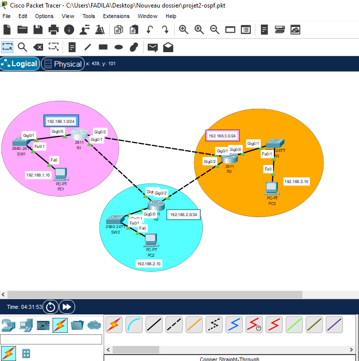
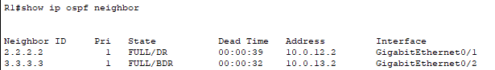
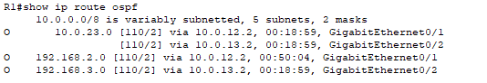
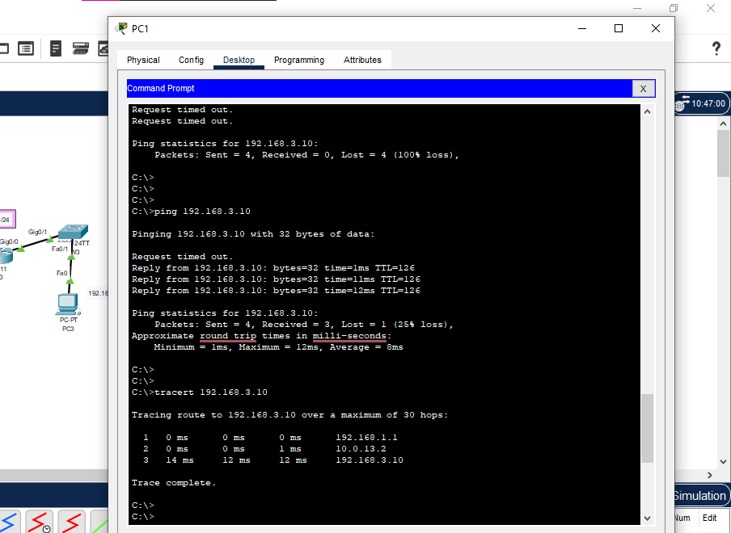
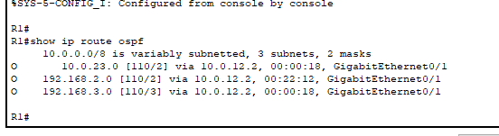
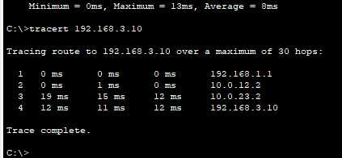

# Projet 2: Routage dynamique OSPF (3 routeurs)

## Objectif
Interconnecter 3 réseaux locaux via 3 routeurs en triangle avec OSPF
(area 0), et démontrer la convergence automatique après une panne de lien.
Projet réalisé avec Cisco Packet Tracer.

## Topologie

## Plan d'adressage

### LANs
| Routeur | Réseau          | Passerelle   | PC                |
|---------|-----------------|--------------|-------------------|
| R1      | 192.168.1.0/24  | 192.168.1.1  | PC1: 192.168.1.10 |
| R2      | 192.168.2.0/24  | 192.168.2.1  | PC2: 192.168.2.10 |
| R3      | 192.168.3.0/24  | 192.168.3.1  | PC3: 192.168.3.10 |

### Liens entre routeurs (/30)
| Lien    | Réseau        | Adresses                    |
|---------|---------------|-----------------------------|
| R1 - R2 | 10.0.12.0/30  | R1: .1 (Gig0/1), R2: .2 (Gig0/1) |
| R2 - R3 | 10.0.23.0/30  | R2: .1 (Gig0/2), R3: .2 (Gig0/2) |
| R1 - R3 | 10.0.13.0/30  | R1: .1 (Gig0/2), R3: .2 (Gig0/1) |

## Technologies
OSPFv2 (area 0), router-id, passive-interface, sous-réseaux /30,
Cisco Packet Tracer

## Configurations
- [R1-config.txt](configs/R1-config.txt)
- [R2-config.txt](configs/R2-config.txt)
- [R3-config.txt](configs/R3-config.txt)

## Vérifications

### Voisinage OSPF (R1)

R1 forme deux adjacences à l'état FULL (R2 et R3).

### Table de routage OSPF (R1)

Les LANs de R2 et R3 sont appris dynamiquement.

### Chemin normal (PC1 vers PC3)

Chemin direct: R1, R3, PC3 (3 sauts).

## Test de panne de lien
Le lien R1 - R3 (Gig0/2 de R1) est désactivé avec `shutdown`.

### Route recalculée

OSPF choisit R2 comme next-hop (10.0.12.2) pour atteindre 192.168.3.0.

### Nouveau chemin

Le trafic passe par R2 puis R3 (4 sauts). La connectivité est maintenue
sans intervention manuelle.

## Problèmes rencontrés et solutions

1. **Adresse IP dupliquée (10.0.12.2)**
   - Cause: la configuration de R2 a été saisie dans la console de R1.
   - Solution: restaurer le hostname et l'IP de R1 (10.0.12.1),
     vérification avec `show ip interface brief`.

2. **Commande non reconnue en mode config**
   - Cause: faute de frappe (`]end`), donc `write memory` et `show` refusés.
   - Solution: `end` puis relancer les commandes en mode privilégié.

3. **Ping impossible entre les LANs**
   - Cause: PC1 sans adresse IP ni passerelle configurées.
   - Solution: configuration statique (IP, masque, passerelle 192.168.1.1).

## Améliorations possibles
- Authentification OSPF (MD5)
- Plusieurs areas (OSPF multi-area)
- Redistribution de route par défaut vers un routeur Internet
- Ajustement des coûts pour contrôler le chemin préféré
- 

R1 forme deux adjacences à l'état FULL (R2 et R3).
